# 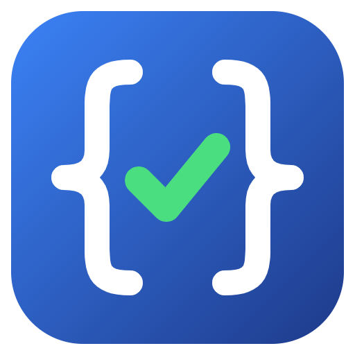 IdeaBlade Validation Editor

A desktop editor for [IdeaBlade Validation](https://github.com/Breeze/ideablade-validation)'s JSON validation metadata (`validation.metadata.json`), so the rules no longer have to be written by hand. It's a first drop: a working prototype, not a finished product.


## Installing

Download the installer for your system from the newest release on the **[Releases page](https://github.com/Breeze/ideablade-validation-editor/releases)** (the one marked Latest). Each release lists its installers with direct links, and what's new.

| | Download | Installing |
|---|---|---|
| **Windows** (x64) | `IdeaBlade-Validation-Editor-Setup-<version>.exe` | Run it. It isn't code-signed, so SmartScreen may warn: *More info* → *Run anyway*. It asks who it's for: everyone (Program Files, with an administrator prompt; the default) or only you. |
| **macOS**, Apple silicon or Intel | `IdeaBlade-Validation-Editor-<version>-mac-arm64.dmg` or `-mac-x64.dmg` | Open it and drag the app to Applications. It isn't signed with an Apple certificate or notarized, so the first time, right-click the app → *Open* → *Open* (or run `xattr -dr com.apple.quarantine "/Applications/IdeaBlade Validation Editor.app"`). |
| **Linux** (x64) | `IdeaBlade-Validation-Editor-<version>-linux-x86_64.AppImage` | `chmod +x` it and run it. |
| **Linux**, Debian or Ubuntu | `IdeaBlade-Validation-Editor-<version>-linux-amd64.deb` | `sudo apt install ./IdeaBlade-Validation-Editor-<version>-linux-amd64.deb` |

To work on the editor itself, see [Running it](#running-it) below.

### Updates

From the first release after 0.1.0-alpha.2, the editor looks for a newer release a few seconds after it starts and every 4 hours, and **Help → Check for Updates…** looks right away (and says so when there's nothing new).

- **Windows** and the **AppImage** update themselves: the new version downloads in the background (the status bar shows how far along it is), then the status bar offers *Restart to update*, which asks about unsaved changes first. Without that, it's installed when you quit.
- **macOS** and the **.deb** can't (the Mac app isn't signed with an Apple certificate, which macOS requires for updates): the status bar says a new version is available, and *Download* opens its release page. Install it over the one you have, as above.

Two settings in the sidebar's Settings decide what happens: *Check for updates automatically* (Help → Check for Updates… works either way) and *Include pre-releases* (alphas, betas and release candidates, marked Pre-release on the Releases page). Checking is on by default; pre-releases are off since 0.1.0, which is the first full release. An alpha you installed earlier still updates to 0.1.0, and once there it follows the new default unless you changed that setting yourself in an alpha. Settings and recent projects stay through updates. Versions up to 0.1.0-alpha.2 don't update themselves: install the newer version over them once.

## What it does

- **Several metadata files, side by side, in JSON, TypeScript or C#.** Open as many as the application has: the server's `validation.metadata.json` and a client's own view model metadata, for example. Each is listed on the left with its model types; the checks, code completion and "Try it" see all of them together, merged as the library merges several metadata maps (`addMetadata`, `AddMetadataJson`). So `ResourceName.firstName`'s `from: 'StaffingResource'` in the client's TS file resolves against the server's JSON, a duplicate error key across files is caught, and a model type in two files gets a note that the library merges them.
  - **JSON files**, as before.
  - **TypeScript:** a `ModelValidationMetadataMap` object literal, as in TempHire's `client-validation-metadata.ts` (`export const x: ModelValidationMetadataMap = { ... }`, or `{ ... } satisfies ModelValidationMetadataMap`). A file with several maps opens as several documents, listed under the file in the sidebar, each map's name on a line of its own. **Add map**, at the top of a TS or C# file's maps, adds another: a new exported, typed constant at the end of a TS file; in C#, a new string constant after the last one, in the same class, with its typed `ModelValidationMetadataMap` next to it when the file has that style (`AdminJson` gets `AdminMetadata`). It's marked new until the file is saved, the file preview shows where it goes, and the name is checked against the file first. A map's ✕ (when its file has more than one) removes it: a new one just goes; one that's in the file is removed after asking and deleted from the file when the file is saved, with its doc comment and, in C#, its typed member. Until then the file shows as unsaved, its preview shows it without the map, and closing it without saving keeps the map. A file's only map goes by closing the file.
  - **Drag to move:** drag a model type (in the sidebar) onto another map, in the same file or another, and it moves there; drag a TS or C# map (its name line) onto another file and the whole map moves: into a TS or C# file as a map of that file, under its name (or into its map of the same name), into a JSON file into that file's map. The target is outlined while you drag; files that can't take it don't. Where the target already has the model type (or a model type of the moved map), they're merged after asking: the rules are combined, with a rule that's in both kept once; properties are merged property by property; a setting both have with different values (`displayName`, `extends`, `required`, ...) keeps the target's value, and the question lists which. The library merges maps that share a model type much the same way when it loads them, except that there the last map's settings win and rules aren't de-duplicated. A map moved out of its file goes like one removed with its ✕; if it was the file's only map, it's left empty there. Both files show as unsaved until saved. Saving rewrites only that object literal, in the Prettier style TempHire uses (single quotes, trailing commas, 100 columns), and keeps the file's line endings: the imports, doc comments and other code stay as they are, and an unchanged map is written back byte for byte. A map with code in it (a spread of another map, a reference to a constant) opens read-only, with the reason.
  - **C#:** the .NET library reads metadata as JSON, so in C# it's a JSON string, usually a raw string literal: `public const string Json = """ { ... } """;` passed to `AddMetadataJson`. Verbatim `@"..."` strings work too. Comments and trailing commas in the JSON are read, as .NET allows them. Saving rewrites only the string, keeping its indentation.
  - Comments inside a TS object or C# JSON can't be kept when it's rewritten: the editor says so, and asks before saving. Use `$comment` for notes that should stay.
  - **New** (File → New, the toolbar's New ▾, or the page shown when nothing is open) makes a JSON, TypeScript or C# document; a TS or C# one shows as the file it will be, and Save suggests `validation-metadata.ts` or `ValidationMetadata.cs`. The Save dialog for a new file starts in the folder last chosen in one, else the open project's folder, else Documents; a file that has a path starts next to it. **Save as…** converts: the extension you choose (.json, .ts, .cs) sets the format. Files are written properly typed. A new TS file gets `import type { ModelValidationMetadataMap } from 'ideablade-validation';` and `export const clientValidationMetadata: ModelValidationMetadataMap = { ... };`, the constant named after the file in camelCase; saving into an existing TS file that doesn't import the type adds that import above its others. A new C# file gets `using IdeaBlade.Validation.Metadata;` and a static class named after the file in PascalCase, with the JSON as `public const string Json` (a C# constant can only be a string; that's what the editor reads and writes) and, typed, `public static readonly ModelValidationMetadataMap Metadata = ModelValidationMetadataMap.Parse(Json);`, registered with `AddMetadata(ClientMetadata.Metadata)` (or `AddMetadataJson(ClientMetadata.Json)`). A new C# file has no namespace: add the project's own. **Save all** saves every changed document. **Discard all** (also File → Discard All Unsaved Changes) does the opposite, after asking and listing what it affects: every file with unsaved changes is read again from disk, maps removed or moved away come back and maps added since go, the project file and its settings are read again, and Untitled documents with changes close.
- **Opens, edits and saves** metadata. Model types are listed on the left, under the file they're in. The list scrolls between the project, the Metadata heading and the search, pinned at the top, and the sources and settings, pinned at the bottom. **Find model types and maps** at the top of that list (also View → Find Model Type or Map, Ctrl+Shift+F) narrows it as you type: model types whose names match, with the matching part marked, and maps or files whose names match in full, with a count of the model types that show; Enter opens the first match and Esc clears it. Clearing it, with Esc or by deleting the text, keeps what you selected in view, unfolding its file or map if needed; files and maps fold with the ▾ before their names, and **Collapse all** / **Expand all** by the Metadata heading fold every file and map (so unfolding a file shows its maps folded) or open everything (a search shows its matches in folded ones too). What's folded is remembered for each project, with your other settings, and folded again when the project opens; each file has its own "model type…" field and Add, at the top of its model types, so a new model type goes into the file you choose (the list offers the types the sources know that the file doesn't have yet). The Add fields stay while you search, so you can find a file by one of its model types and add another to it there; what you add stays in the list, matching or not, until the search is cleared. For each one you see its `extends`, `condition`, `$comment`, model-level rules (with `id`, `condition` and `propertyNames`) and properties (`from`, `displayName`, `required`, `minLength`, `maxLength`, rules). Groups (`{ "group": ..., "validators": [...] }`) are edited in place. A model with many properties or rules is easier to work through with the searches above them: **Find properties and rules…** narrows the properties to those whose name, display name, `required`/`minLength`/`maxLength` or rules (validator, `id`, `condition`, message, settings, `$comment`) have every word you type, in any order (`chk amt`, `range 999999.99`, `balance due`), with a count of those that show; **Find rules…** does the same for the model-level rules, and for the global rules in a map's settings, keeping a group (and only its matching rules) when its name or one of its rules matches. Enter opens the first match and Esc clears the search; rules can't be moved while one is on, and adding a property or rule ends it. `$schema`, `$comment` and anything the forms don't know about are kept.
- **Forms instead of raw JSON.** Validator names come from a list: the built-in validators and the application's own (see Sources). Each validator shows its description, default message and context settings: for the built-in ones from the library's `docs/validators.md` (`minValue`/`maxValue` for `range`, `other`/`op` for `compare`, `values`, and so on), for the application's from what their code reads. `pattern`'s `flags` are toggles for `i`, `m`, `s` and `u`, each saying what it does in the browser and on the .NET server: the server honours `i`, `m` and `s`, and ignores `u`. Each rule shows the error key it will get (`name[_group]_property`, or `name[_group]_id` for model-level rules).
- **A regular expression panel for `pattern` rules**, with what an online regex tester gives, without leaving the editor:
  - the pattern coloured by its parts (anchors, character classes, groups, repeats, alternatives), with an explanation of each part when you hover it, and the whole pattern explained step by step ("the start of the value, then one of A–Z, a–z, a space, one or more times, then the end of the value");
  - **values to try**: lines that should pass and lines that should fail, each marked ✓ or ✗ as you type, with the matched part underlined. They're tested the way the validator tests them (`test()` from the start of the value; empty values pass). The values are kept with the rule, so they're there to check the pattern again at the next edit: in the project file (`regexTests`), saved when you save the metadata, so the team shares them; without a project file, for you alone. They're keyed like the rule's error key (`PhoneNumber.areaCode`, `Address.city@submit`, `Order#DATES_IN_ORDER` for a model-level rule) and move along when you rename the model, the property or the group, or change a model-level rule's id. TempHire's project files have them for its two `PhoneNumber` patterns;
  - **hints** for the mistakes that matter in a validator: a pattern without `^` and `$` passes when any part of the value matches (with a button that adds them), `m` making `^`/`$` work per line, and what the .NET server, which ignores the `u` flag, does differently: `\p{L}` without `u` is the text `p{L}` in the browser but a Unicode category on the server; `\u{…}` and `\p{Script=…}` make the server throw when it creates the validator (also reported as an error in the checks); with `s` or `\p{…}` the server's `\d` and `\w` accept non-ASCII digits and letters; and an emoji is one character in the browser with `u` but two on the server. Syntax errors point at the exact position;
  - **common patterns** to start from (letters only, a name, a code, no leading or trailing spaces…), with a note where a built-in validator such as `zipCode` or `phone` does the same.

  It's built on [regexpp](https://github.com/eslint-community/regexpp), the regular expression parser ESLint uses.

  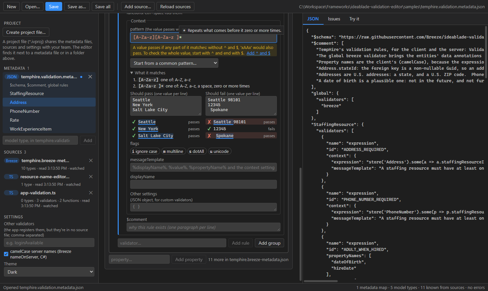
- **Code completion in expressions** (model conditions, rule conditions, the `expression` validator). As you type, or with Ctrl+Space, it offers what the library puts in scope there:
  - the variables: `model`, `value` (rules only), `context`, `isClient`, `isServer`, `store(type)`, and for model conditions `entityInfos` and `findEntity(id, type)`;
  - the model's properties, with their types, and the members of those types: `model.firstName.` offers the string methods, `value.` on a date the `get…` methods, `model.addresses.` the array methods;
  - entities across the store: `store('` offers the model types, `store('Address').some(a => a.` the properties of an address; callback parameters in general get their element type;
  - what `context` always holds (`model`, `modelType`, `propertyName` or `propertyNames`, `displayName`, `messageTemplate`, `isClient`, ...) plus the rule's own settings;
  - the application's expression functions (see Sources), and the globals and methods the safe evaluator allows (`Math`, `Date`, `Number`, `Object`, ...).

  Completion only suggests: properties it doesn't know (values a context provider adds, members of a type no source describes) can still be typed. Syntax errors are underlined where the parser stops.
- **Sources: pick real models, properties, validators and functions.** Add Breeze metadata (Breeze's native JSON, as a Breeze server's `Metadata` endpoint returns it), or TypeScript or C# files with view models, DTOs and form models, and with the application's own validators and expression functions. Their types appear when you add a model, and their properties when you add a property, set `propertyNames`, `compare`'s `other`, `extends` or `from`, and in expressions. Names the sources don't know are flagged as warnings, so typos show up. `from` lists `Type.property` for every known property, with its type, and a bare `Type` first where that type has a property of the same name (the one the library takes); a bare type without one is an error that says so, and a `from` whose property holds another kind of value (true/false for text, say) gets a warning. Rules for models that are in no source (a view model you haven't pointed it at) still work. Fields that offer names (a new model type, `extends`, `from`, a new property, a validator, compare's `other`, a model-level rule's property names, Try it's model type, and the regular expression panel's common patterns) are searchable lists: type any part of a name, or several parts (`cust name` finds `Customer.name`), and the list narrows to what matches, the matching letters marked; ▾ or ↓ shows the whole list, ↑/↓ and Enter pick, Esc closes it. What's typed is used as it is when it isn't in the list. A model-level rule's property names are chips with ✕, plus a field that adds one. A new property is offered from the sources, and also from the names the metadata uses for the type in other open maps or for the type it extends; with neither, the list says so and how to get them (add the model's file as a source). **Add source…** (Ctrl+M) adds files; **Add folder…** (Ctrl+Shift+M) adds a folder as a pattern, `<folder>/**/*.{ts,cs}`: its TypeScript and C# files, in it and its subfolders (not `node_modules`), are sources, and new ones are picked up as they're written. In the Sources list a pattern is one entry, folded by default, with its file count; ▸ shows its files. ✎ (or a double-click) changes it, say to `server/Dtos/Admin/*.cs` or `**/*.dto.ts` (relative to the project's folder), and ✕ removes it with the sources it brought in. Its files can't be removed one by one: change the pattern instead.
  - **Breeze:** entity and complex types, with data and navigation properties. Server names (`nameOnServer`) are camel-cased, as the metadata's property names are (switch this off in Settings).
  - **TypeScript:** interfaces, object type aliases, and classes with their public properties, getters and constructor parameter properties. Angular components, services, directives and pipes are skipped, and so are validator classes. Read with the TypeScript compiler API.
  - **The application's validators, TS:** `syncValidator('name', …, 'message')`, `asyncValidator(…)`, `{ name: 'x', fn: … }` factories, and classes extending `SyncValidator` / `AsyncValidator` (`super('name', …)`, `withMessage(context, '…')`). Their settings are the context values their code reads: `ctx.factor`, `ctx['factor']`, `const { factor } = ctx`, `(value, { factor }) => …`.
  - **The application's validators, C#:** classes deriving from `Validator`, `SyncValidator` or `AsyncValidator` (`base("name", …)`, `WithMessage(context, "…")`), and `new ValidatorFactory("name", …)`. Settings come from `GetValue<T>("x")` (typed: a number becomes a number field, `bool` a checkbox), `GetValues<T>("x")` (a list) and `context["x"]`.
  - **Expression functions:** `expressionScope: { … }` and `provideExpressionScope(…)` (TS), `AddExpressionFunction("name", (Func<…>)(…))` (C#), with their parameters and return types where the code says.
  - The checks know these validators: no "unknown validator" for them, and an error when a rule's `async` doesn't match how the validator is registered. Validators that are in no source file can be listed under Settings → Other validators.
  - **C#:** classes, records (including positional parameters) and structs with their public instance properties, base classes and `[StringLength]`/`[MaxLength]` hints. This is a lightweight reader rather than a compiler, enough for DTOs and view models.
  - **Kept up to date:** each source file is watched and read again when it changes (also **Reload sources**, F5).
- **A project file to share with the team:** an IdeaBlade Validation Project, `*.ivproj` (JSON), next to the metadata or in a folder above it, lists the metadata files to open together, the sources and the shared settings (other validators, camelCase). Paths are relative to it, and sources can be patterns, such as a folder of DTOs. TempHire's, `temphire.ivproj` at the root of temphire.angular, takes the entities from the Breeze metadata that `npm run model` exports (and generates the entity classes from), plus the view models that aren't in it:

  ```json
  {
    "metadata": [
      "server/TempHire.Server/Validation/validation.metadata.json",
      "client/src/app/core/validation/client-validation-metadata.ts"
    ],
    "sources": [
      "client/metadata.json",
      "client/src/app/core/projections/*.ts",
      "client/src/app/resource-mgt/resource-name-editor.component.ts"
    ],
    "otherValidators": [],
    "camelCase": true
  }
  ```

  Opening the project file (Open…, **File → Open Recent Project**, or on the command line) opens its metadata files and loads its sources. Another project replaces what's open, after asking about unsaved changes; the one that's open already stays as it is. The recent list has the last 10 projects, the latest first (Alt+F, R, 1 opens the latest), leaves out the ones that have been moved or deleted, and can be cleared; Windows shows them in the taskbar's jump list too, and the page shown when nothing is open lists them under its buttons, the file name and its folder, a click opening one. **File → Close Project** closes its files and sources, after asking about unsaved changes, and leaves nothing open; the editor then starts with nothing open too, until a project is opened again. Opening one of its metadata files finds the project (the `*.ivproj` in that folder, or in the nearest folder above that has one; with several, the first by name) and uses its sources and settings. **Create project file…** in the sidebar writes one from what's open, named after its folder by default. The installer registers `.ivproj`, so double-clicking a project opens it in the editor. The content is JSON: to have VS Code colour it as such, map it in `files.associations` (`"*.ivproj": "json"`). Changes (added or removed sources, metadata files opened or closed, settings) show as unsaved until you save the project, with Save all or its own Save. A metadata file is closed with the ✕ next to it, which takes it out of the project, as removing a source does; opening it again puts it back. A file the project lists that doesn't open (moved, or broken) stays in it. **New files are picked up:** the folders a pattern points at are watched, so a new DTO appears as a source as soon as its file is written, and a deleted one goes; Reload sources (F5) expands the patterns again too. Patterns are saved as they are, relative to the project file, whether they were written by hand or added with Add folder; one added and not saved yet is watched too. The project file is watched too (see below). Keys the editor doesn't know, such as `$comment`, are kept. Without a project file, the editor remembers the sources per metadata file for you alone (in its app data).
- **Checks as you edit** (Issues tab, and next to each field). Clicking an issue in the Issues tab takes you to it: its model type is selected, the property and rule cards it's in open, and its message under the field is scrolled to and highlighted, so you can fix it there; the Issues tab stays open for the next one. An issue the forms don't show anywhere goes to its line in the JSON view.
  - **Schema:** against `validation-metadata.schema.json` from the installed `ideablade-validation` package.
  - **The library:** `ideablade-validation` itself checks what the schema can't. It reports unknown validator names, `async` that doesn't match an app validator's registration, regular expression flags that are invalid, have no effect (`g`) or behave differently on client and server (`y`, `v`), expressions and conditions that don't parse (`checkExpression`), invalid `pattern`s, and `from`/`extends` that lead nowhere. It also runs the duplicate error key check (`ModelMetadata.checkErrorKeys`), which the service runs before it first validates a model type. Rule sources work as in the app: a `from` that names a Breeze entity resolves, as it does with `breezeRuleSource`.
  - **Sources:** properties, `propertyNames` and `compare`'s `other` that the model doesn't have.
  - **Kinds of value:** a validator meant for another kind of value than the property holds (`pattern` or `maxLength` on a true/false, `multipleOf` on text) is a warning, and so is `date` on text without `allowString`. The property's kind (text, number, true/false, date) comes from its type in the sources. The built-in validators' kinds come from how the library's code treats values. The application's own validators' kinds are read from their code: a typed value parameter (`(login: string) =>`), arithmetic or `Number.isInteger` (a number), Date methods, string methods, and in C# `Convert.ToDecimal(value)`, `(DateTime)value` or `value is string`. A validator that makes text of any value (`String(v)`, `value?.ToString()`), or whose code doesn't say, counts as fitting anything. On a property's rules, the validator lists show what each limited validator is for and mark the ones that don't fit with ⚠.
- **JSON view** next to the forms, kept in step both ways. For metadata in a TypeScript or C# file, the pane (named TypeScript or C# then) shows that file as saving would write it: its imports or usings, comments and other code as they are, and each map with unsaved changes written as Save writes it, updated a moment after each edit. It's read-only there, as only the metadata objects are written; a switch above it shows the map's JSON, which can be edited. It's a code editor, as in VS Code: Enter indents the new line to the level of the one before it, and Enter after `{` or `[` puts the cursor one level in with the closing bracket on its own line below. It also adds closing brackets and quotes, shows the matching bracket, folds objects and arrays, has line numbers and VS Code's JSON colours, and searches with Ctrl+F. Tab and Shift+Tab indent and outdent; press Esc first to move focus on with Tab instead. A syntax error is underlined where the parser stops. JSON that doesn't parse isn't applied; the forms keep the last valid state until it parses again. Undo there undoes your typing, not edits made in the forms.
- **Try it:** validate a sample object against the metadata as it is now, with the library's real service. You can give it a store (entities by type) for `store('Type')` expressions. Validators the editor doesn't have (`breeze`, custom ones) pass, and async validators don't run.
- **Files changed outside the editor:** the open metadata files and the project file are watched too, but unlike sources they aren't reloaded on their own, since you may be in the middle of editing them. When one changes on disk (in another editor, another session, a `git pull`), a dialog names the changed files, says which have unsaved changes that reloading would discard, and asks whether to **Reload** or **Keep the editor's version**. A file deleted on disk only gets a note in the status bar; saving writes it again. Saving checks first: if the file on disk is no longer what the editor read or last saved, it warns that saving would overwrite those changes and offers **Overwrite**, **Reload from disk** or **Cancel**. This holds for every save, metadata and project file alike, including the `regexTests` the editor writes to the project. The editor's own saves don't count as outside changes.
- **Dark theme** by default, with VS Code's Dark+ colours, also for the code in expressions. Settings → Theme switches to Light, or to Follow Windows; the window frame, menus and dialogs follow.
- **The editor opens where you left it:** the project you used last (opened, found next to a metadata file, or created), when it's started without files on its command line, as from the Start menu; the window's size, position and maximised state; the widths of the sidebar and the right pane, which the splitters between the columns change (Esc while dragging puts them back; double-click one for its default, or View → Reset Layout for both; the middle column keeps at least 460 px, so a narrower window takes from the right pane first); and what was selected in the sidebar (a model, or a file's settings) and which files and maps were folded, for each project, or for the first metadata file without one. These are your settings, so they're kept in the app's data folder (`window-state.json`), not in the project file. A position that's no longer on a screen, after unplugging a monitor, is replaced by a centred window of the same size. A project that has been moved or deleted since isn't reopened: the editor starts with nothing open, offering Open… and New. With nothing remembered, the first model in the list is selected.

| Several files: JSON and TS side by side | Code completion in an expression | The application's own validators |
|---|---|---|
|  | 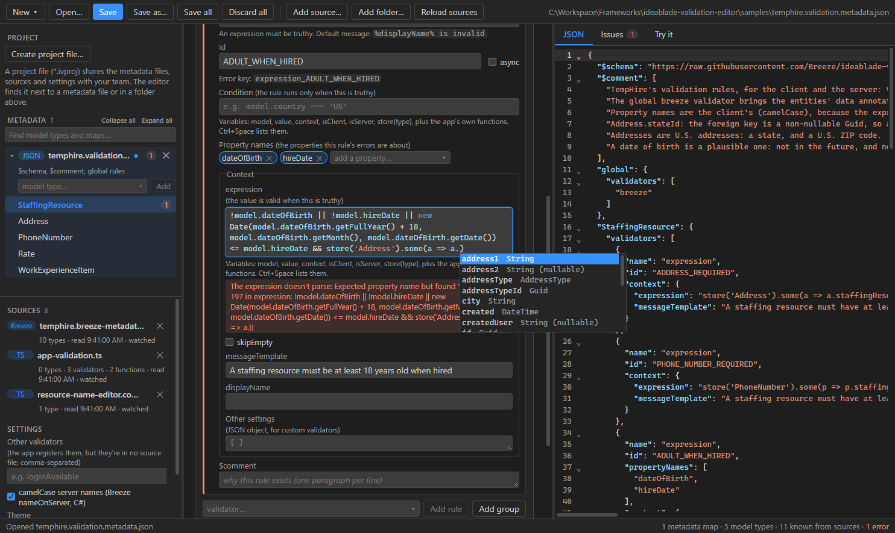 | 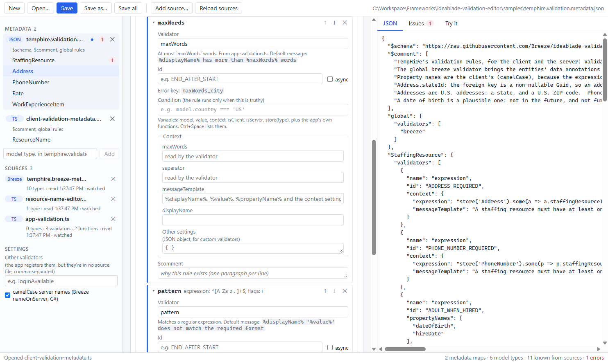 |

| Rules for a view model from a TS file | The duplicate error key check | Try it |
|---|---|---|
| 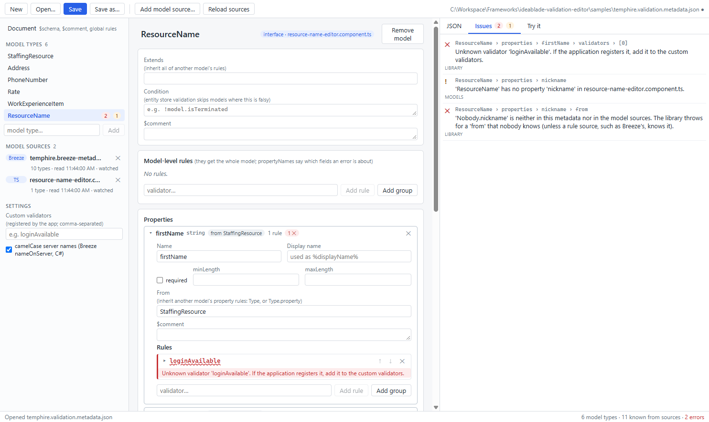 |  | 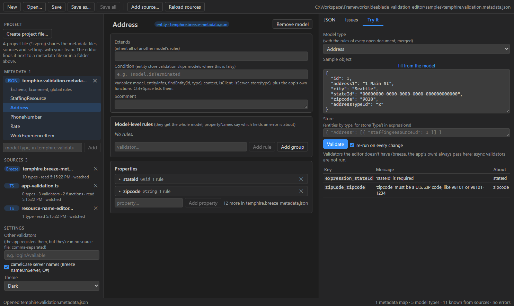 |

| TempHire's project file, with its pattern's values to try | The JSON view: folding, search, VS Code's colours | A file changed outside the editor |
|---|---|---|
|  | 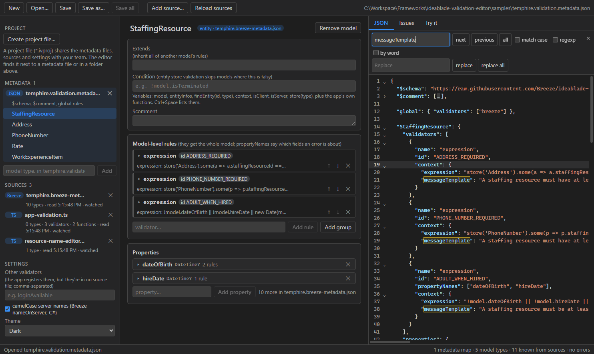 | 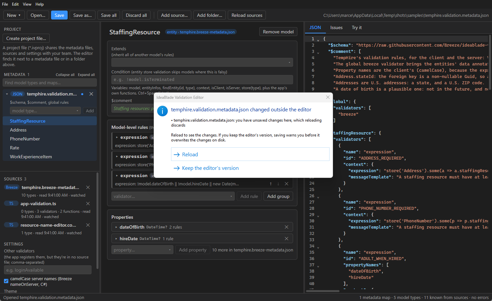 |

| A TS file with a second map (Add map), shown as the file | The start page, with the recent projects | New: JSON, TypeScript or C# |
|---|---|---|
| 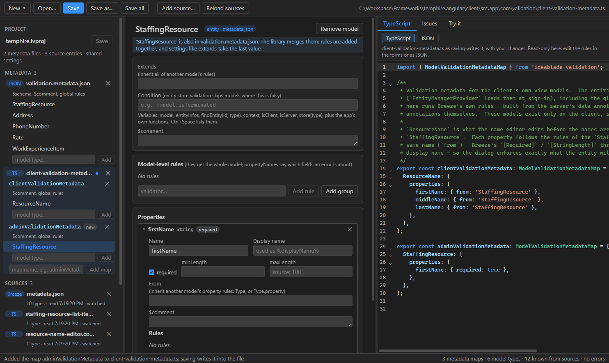 | 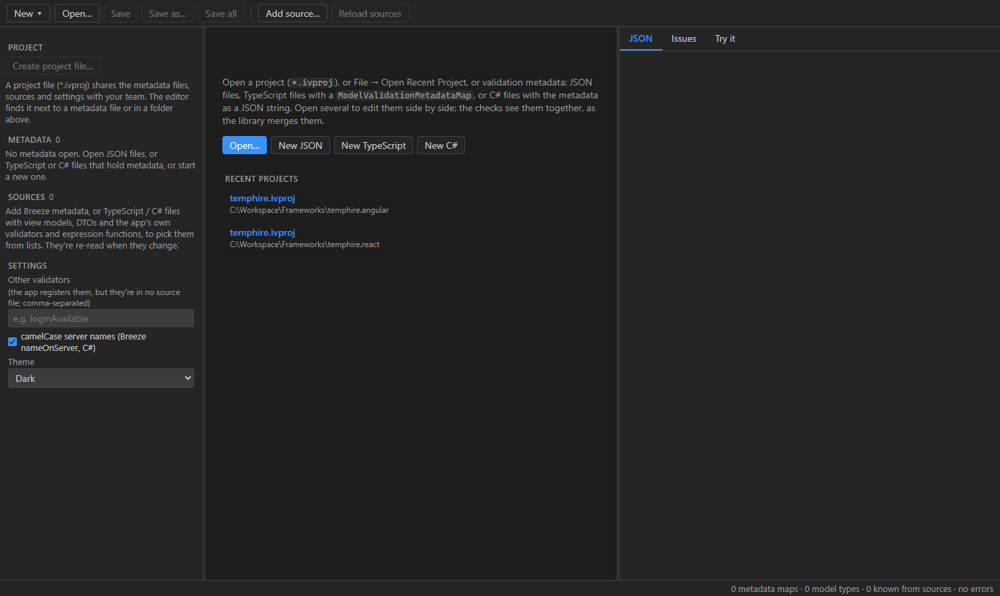 | 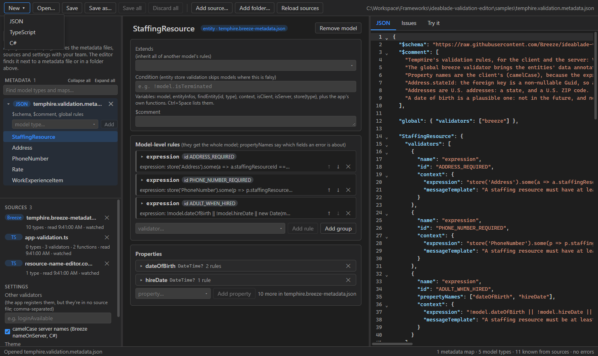 |

| Searchable lists: `from` narrowed to `staff name` | A validator that doesn't fit its property | Sources from a folder, as a pattern |
|---|---|---|
| 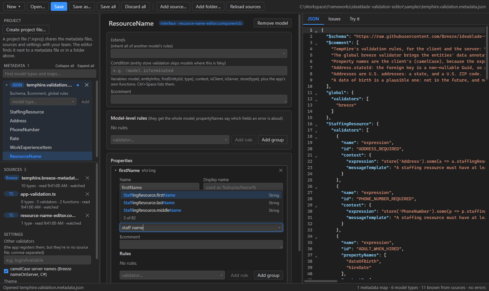 | 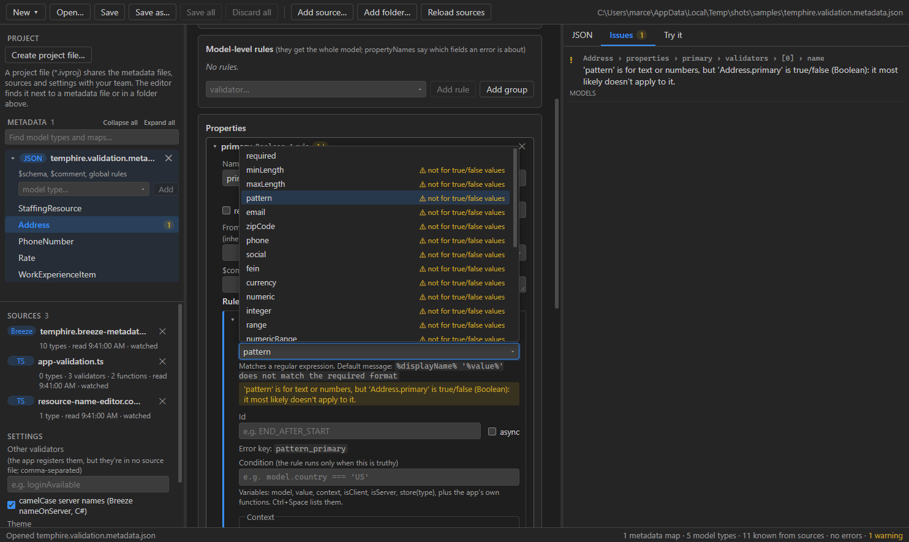 | 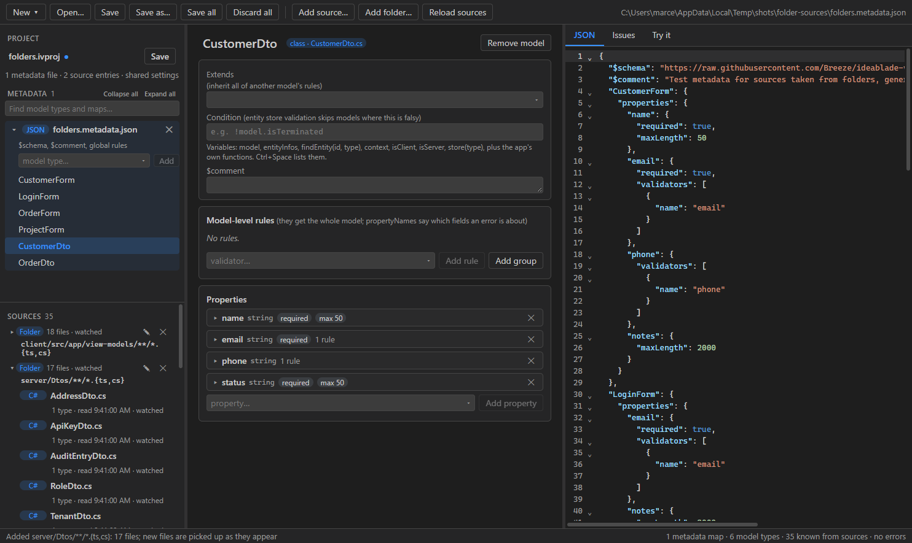 |

## Running it

Node 26.13.1 (the current LTS; `.node-version`) to build and run the tooling. With nvs: `nvs use 26.13.1`. The app itself runs on the Node inside Electron (24.22 in Electron 45).

```powershell
npm install
npm start
```

`npm start` builds the Angular app into `dist/` and starts Electron on it. The first start downloads the Electron binary.

While working on the editor, `npm run dev` runs `ng serve` (port 4300) with live reload and Electron pointed at it.

A project file, metadata files (JSON, TS or C#) and sources can be given on the command line; without any, the editor reopens the project used last. TempHire's Angular client has a project file at its root:

```powershell
npm run build
npx electron . ../temphire.angular/temphire.ivproj
```

Or files and sources one by one:

```powershell
npx electron . samples/temphire.validation.metadata.json --source=samples/temphire.breeze-metadata.json --source=samples/app-validation.ts
```

The `samples/` folder has TempHire's validation metadata and its Breeze metadata, exported from `TempHirePersistenceManager.Metadata()`, and `app-validation.ts`, an example of an application's own validators and expression functions as the editor reads them. Two test projects, each with a `generate.cjs` that writes it again: `large-project/large.ivproj`, 13 metadata files with about 200 model types, for the sidebar's scrolling, search and folding; and `folder-sources/folders.ivproj`, for sources taken from folders: 18 TypeScript view models in `client/src/app/view-models` and its subfolders, which the project lists as a pattern, and 17 C# DTOs in `server/Dtos` to add with Add folder….

### Tests

```powershell
npm test
```

Unit tests (Vitest, through Angular's test builder) cover the Breeze and C# readers, metadata in C#, the checks on TempHire's metadata, completion, and the tester. The main process's code (metadata in TypeScript, the project file, the settings file, picking the newest release) is tested by `electron/**/*.test.ts`, next to the code they test and compiled with the rest of the main process and run with Node's test runner on **Electron's own Node** (24.22 in Electron 45), because that's what it runs on in the app, whatever `.node-version` says: `.node-version` only picks the Node that builds the app and runs the tooling.

## Packaging

Releases are built by GitHub Actions (`.github/workflows/release.yml`): pushing a tag such as `v0.1.0-alpha.1` builds the installers for Windows (NSIS `.exe`), macOS (a `.dmg` each for Intel and Apple silicon) and Linux (AppImage and `.deb`), each on its own runner, after the tests, and attaches them to a GitHub release for the tag (a pre-release when the version has a hyphen), with the notes in `.github/release-notes/<tag>.md`. The version is `package.json`'s, so set it before tagging. None is signed with a certificate: Windows SmartScreen warns, and on macOS the app is only signed ad hoc (`scripts/adhoc-sign-mac.cjs`, so Apple silicon runs it) and not notarized, so it's opened with right-click → Open the first time.

Locally (`npm run dist:mac` and `npm run dist:linux` need macOS and Linux):

```powershell
npm run dist
```

This builds a Windows installer with electron-builder: `release/IdeaBlade-Validation-Editor-Setup-<version>.exe`. It's an NSIS installer that asks who the app is for: "Anyone who uses this computer" (the default: `C:\Program Files`, with an administrator prompt) or "Only me" (`%LOCALAPPDATA%\Programs`, no prompt). The folder can be changed. Installing again over an existing installation keeps its choice. `npm run dist:dir` builds only the unpacked app (`release/win-unpacked/`), which is quicker for checking the packaged build. The installer isn't code-signed.

The icon (JSON braces around a check: validation metadata whose rules pass) is drawn in `build/icon.svg`, with a bolder `build/icon-small.svg` for 16–24 px, where the thin lines blur. `npm run icon` renders both with Electron into `build/icon.ico` (16–256 px), used for the window, the exe and the installer, the same as `build/ivproj.ico` for `.ivproj` files on Windows, and `build/icon.png` (512 px). Run it after changing either SVG, and commit the results.

npm 11 lists some packages whose install scripts it didn't run (`esbuild`, `lmdb`, `@parcel/watcher`, `electron-winstaller`, `msgpackr-extract`). The build doesn't need them: esbuild and the watchers come as prebuilt optional packages, and electron-winstaller is only for Squirrel installers.

### Releasing

A release is a tag on a commit whose `package.json` has that version, with release notes next to it. For `0.1.0-alpha.2`:

1. Set the version, which names the installers and is the version the app reports:

   ```powershell
   npm version 0.1.0-alpha.2 --no-git-tag-version
   ```

2. Write the release notes in `.github/release-notes/v0.1.0-alpha.2.md` (without them, GitHub generates notes from the commits since the last tag). The installers' names follow from the version, so the notes can link straight to them, as [v0.1.0-alpha.1's](.github/release-notes/v0.1.0-alpha.1.md) do: `https://github.com/Breeze/ideablade-validation-editor/releases/download/<tag>/<file>`, with the files `IdeaBlade-Validation-Editor-Setup-<version>.exe`, `IdeaBlade-Validation-Editor-<version>-mac-arm64.dmg` and `-mac-x64.dmg`, `-linux-x86_64.AppImage`, and `-linux-amd64.deb`.
3. Commit both and push to `main`.
4. Optionally, build the installers once without releasing anything, to catch a broken build before there's a tag to move: Actions → Release → Run workflow, or

   ```powershell
   gh workflow run release.yml -R Breeze/ideablade-validation-editor
   ```

5. Tag that commit and push the tag:

   ```powershell
   git tag -a v0.1.0-alpha.2 -m "0.1.0-alpha.2"
   git push origin v0.1.0-alpha.2
   ```

The Release workflow then checks that the tag matches `package.json`'s version (and stops before building if it doesn't), runs the tests and builds the installers on Windows, macOS and Linux, and creates the GitHub release with them attached: a pre-release when the version has a hyphen (`-alpha.2`, `-rc.1`), a normal release otherwise. A tag that already has a release can't make another; a broken one is fixed with a new version.

Each release also carries the files the installed editors update from: `latest.yml` (Windows) and `latest-linux.yml` (the AppImage), which name the version and its installer's checksum, and a `.blockmap` per installer, so an update only downloads what changed. electron-builder writes them because of the `publish` entry in `package.json`'s `build` (the workflow still publishes with `gh`, not electron-builder), and the workflow attaches them with the installers. They have to be there: a release without them breaks the automatic updates until the next one. The update code is in `electron/updates/`: `updater.ts` uses [electron-updater](https://www.electron.build/auto-update) on Windows and for the AppImage, and on macOS and for the `.deb` reads GitHub's list of releases (`releases.ts`).

To try updates without a release, build a newer installer into a folder of its own and serve it as a feed; `IVE_UPDATE_FEED` points the editor at it instead of GitHub, and also turns the checks on when running from source (from source it downloads the update but never installs it):

```powershell
npm run build; npm run build:electron
npx electron-builder --win nsis --publish never -c.extraMetadata.version=0.1.0-alpha.99 -c.directories.output=$env:TEMP\ive-feed
npx http-server $env:TEMP\ive-feed -p 8765        # or any static file server
$env:IVE_UPDATE_FEED = 'http://localhost:8765'; npx electron .
```

The status bar should go from *Downloading version 0.1.0-alpha.99…* to *Version 0.1.0-alpha.99 is ready*. With a feed version that isn't newer, Help → Check for Updates… says you have the latest version.

## How it's built, and why

- **Electron**, for a desktop app that opens and saves files and watches the model sources. The main process (`electron/`) owns the file system: dialogs, reading, saving, `fs.watch`, and reading TypeScript files, since the TypeScript compiler needs Node. Its entry point, `electron/main.ts`, only starts it; the code is in folders by what it does: `window/` (the window and the menu), `ipc/` (the requests the renderer makes, one file per group: files, TypeScript, the project, sources, settings), `project/` (the project file and source patterns), `settings/` (the user's settings file) and `typescript/` (reading models and metadata from TypeScript), with the payload types in `types.ts`. The renderer is sandboxed with context isolation and gets a small API through `electron/preload.ts`, which `src/app/services/host.ts` describes for the renderer. The main process is TypeScript too, compiled by `tsc -p tsconfig.electron.json` (`npm run build:electron`) into `dist-electron/`, which is what Electron and the installers run; `npm start`, `npm run dev`, `npm test` and the `dist` scripts compile it first.
- **Angular 22** (standalone components, signals, zoneless) for the UI. All state is in one signal store (`src/app/services/editor-store.ts`): the document is the parsed JSON itself, and every edit replaces it immutably. The JSON text, the issues and the model catalog are `computed`s of it, so the forms, the JSON view and the checks can't get out of step. The code under `src/app/`:
  - `app.ts` (with `app.html`, `app.css`): the shell. The window's layout and splitters, the menu's commands, startup.
  - `components/`: one folder per component, each with its `.ts`, `.html` and `.css`. The shell's parts (toolbar, sidebar with project panel, metadata search and list, sources list and settings, start page, right pane, status bar) and the editors (model, property, rule list and rule, regular expression, expression field, the document's settings, JSON view, issues, Try it).
  - `services/`: the store, one open map (`metadata-document.ts`), the sidebar's grouping, folding and search (`metadata-tree.ts`), the bridge to the main process (`host.ts`) and the theme.
  - `shared/`: small helpers more than one component uses.
  - Styles: `src/styles.css` has the theme's colours and what all components share (buttons, inputs, badges, headings); each component's own styles are in its `.css`, scoped to it.
- **The library itself** (`ideablade-validation` from npm) does the checks the schema can't do and runs the tester. The editor uses the same code the apps run, so it agrees with them.
- **Ajv** checks the schema. The validator is precompiled at build time (`scripts/build-schema-validator.mjs`, into `src/generated/`), so the app's Content-Security-Policy needs no `unsafe-eval`.
- The editor's own logic is plain TypeScript in `src/lib/` and doesn't depend on Angular: the document helpers, the validator catalog, the source readers, metadata in C#, expression completion, the checks and the tester. Metadata in TypeScript is read and written in `electron/typescript/` (`metadata-read.ts`, `metadata-write.ts`), in the main process, with the TypeScript compiler. Expression fields, the pattern field and the JSON view use CodeMirror 6.

## Limitations of this first drop

- Saving a JSON file after a form edit writes the whole file in standard two-space JSON. Hand formatting is lost, such as TempHire's one-line `"global": { "validators": ["breeze"] }`. Edits in the JSON view are saved as typed. TS objects and C# strings are rewritten in a fixed style (Prettier's for TS), so hand formatting inside them is lost too, and so are comments inside them.
- Metadata built in code (TS maps put together with spreads or functions, C# built from `ModelValidationConfig` objects) can't be edited: TS maps with code open read-only, and C# is read only as JSON strings.
- The documents are listed one above the other in one window; there is no split view showing two model editors at once.
- Breeze metadata comes from a file. TempHire's `api/model/Metadata` endpoint needs a signed-in user, so save its response, or export it as `samples/` was.
- Model sources supply names, not rules: `from` a Breeze entity resolves, but in "Try it" the inherited Breeze rules (`[Required]`, `[StringLength]`) don't run.
- C# is read with patterns, not Roslyn. Unusual syntax (properties split over several lines, generics with nested angle brackets in property types) may be missed.
- A validator's settings are found only where its own code reads them (`ctx.x`, `GetValue<T>("x")`). Settings read through a helper method, or a validator class defined in a file that isn't a source, are not.
- Completion follows the types it can see: model properties, `store('Type')`, array callbacks. A value whose type no source describes (`context.someProviderValue.`, an app function returning an untyped object) gets no member suggestions.
- In "Try it", the application's validators always pass: the editor can't run their code.
- No undo beyond the JSON view's own; no drag and drop to reorder rules (use ↑/↓).
