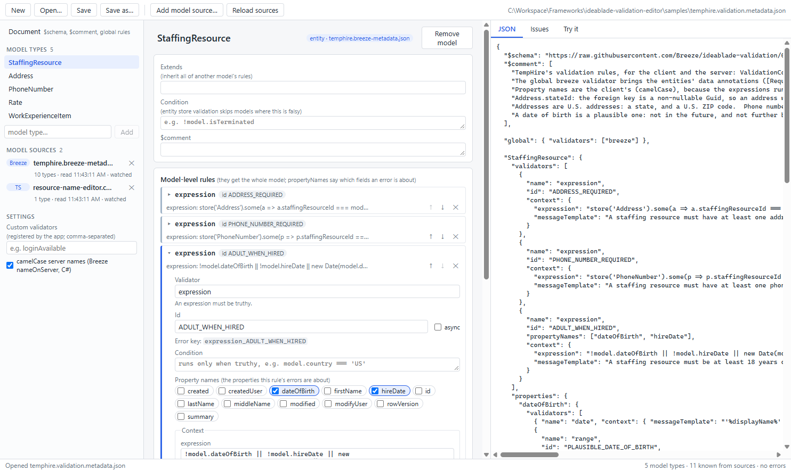

# IdeaBlade Validation Editor

A desktop editor for [IdeaBlade Validation](https://github.com/Breeze/ideablade-validation)'s JSON validation metadata (`validation.metadata.json`), so the rules no longer have to be written by hand. It's a first drop: a working prototype, not a finished product.



## What it does

- **Opens, edits and saves** a metadata file. Model types are listed on the left. For each one you see its `extends`, `condition`, `$comment`, model-level rules (with `id`, `condition` and `propertyNames`) and properties (`from`, `displayName`, `required`, `minLength`, `maxLength`, rules). Groups (`{ "group": ..., "validators": [...] }`) are edited in place. `$schema`, `$comment` and anything the forms don't know about are kept.
- **Forms instead of raw JSON.** Validator names come from a list of the built-in validators (and your custom ones). Each validator shows its context settings from the library's `docs/validators.md`: `minValue`/`maxValue` for `range`, `other`/`op` for `compare`, `expression` for `expression` and `pattern`, `values`, and so on. Each rule shows the error key it will get (`name[_group]_property`, or `name[_group]_id` for model-level rules).
- **Model sources: pick real models and properties.** Add Breeze metadata (Breeze's native JSON, as a Breeze server's `Metadata` endpoint returns it), or TypeScript or C# files with view models, DTOs and form models. Their types appear when you add a model, and their properties when you add a property, set `propertyNames`, `compare`'s `other`, `extends` or `from`. Names the sources don't know are flagged as warnings, so typos show up. Rules for models that are in no source (a view model you haven't pointed it at) still work.
  - **Breeze:** entity and complex types, with data and navigation properties. Server names (`nameOnServer`) are camel-cased, as the metadata's property names are (switch this off in Settings).
  - **TypeScript:** interfaces, object type aliases, and classes with their public properties, getters and constructor parameter properties. Angular components, services, directives and pipes are skipped. Read with the TypeScript compiler API.
  - **C#:** classes, records (including positional parameters) and structs with their public instance properties, base classes and `[StringLength]`/`[MaxLength]` hints. This is a lightweight reader rather than a compiler, enough for DTOs and view models.
  - **Kept up to date:** each source file is watched and read again when it changes (also **Reload sources**, F5). The sources are remembered per metadata file and loaded again when you open it.
- **Checks as you edit** (Issues tab, and next to each field):
  - **Schema:** against `validation-metadata.schema.json` from the installed `ideablade-validation` package.
  - **The library:** `ideablade-validation` itself checks what the schema can't. It reports unknown validator names (add your app's own under Settings → Custom validators), expressions and conditions that don't parse (`checkExpression`), invalid `pattern`s, and `from`/`extends` that lead nowhere. It also runs the duplicate error key check (`ModelMetadata.checkErrorKeys`), which the service runs before it first validates a model type. Rule sources work as in the app: a `from` that names a Breeze entity resolves, as it does with `breezeRuleSource`.
  - **Model sources:** properties, `propertyNames` and `compare`'s `other` that the model doesn't have.
- **JSON view** next to the forms, kept in step both ways. JSON that doesn't parse isn't applied; the forms keep the last valid state until it parses again.
- **Try it:** validate a sample object against the metadata as it is now, with the library's real service. You can give it a store (entities by type) for `store('Type')` expressions. Validators the editor doesn't have (`breeze`, custom ones) pass, and async validators don't run.

| Rules for a view model from a TS file | The duplicate error key check | Try it |
|---|---|---|
|  |  |  |

## Running it

Node 26.13.1 (the current LTS; `.node-version`). With nvs: `nvs use 26.13.1`.

```powershell
npm install
npm start
```

`npm start` builds the Angular app into `dist/` and starts Electron on it. The first start downloads the Electron binary.

While working on the editor, `npm run dev` runs `ng serve` (port 4300) with live reload and Electron pointed at it.

A metadata file and model sources can be given on the command line, which is handy for trying it out on TempHire:

```powershell
npm run build
npx electron . samples/temphire.validation.metadata.json --source=samples/temphire.breeze-metadata.json --source=../temphire.angular/client/src/app/resource-mgt/resource-name-editor.component.ts
```

The `samples/` folder has TempHire's validation metadata and its Breeze metadata, exported from `TempHirePersistenceManager.Metadata()`.

### Tests

```powershell
npm test
```

Unit tests (Vitest, through Angular's test builder) cover the Breeze and C# readers, the checks on TempHire's metadata, and the tester.

## Packaging

```powershell
npm run dist
```

This builds a Windows installer with electron-builder: `release/IdeaBlade Validation Editor Setup 0.1.0.exe`. It's an NSIS installer for the current user, where you can choose the folder. `npm run dist:dir` builds only the unpacked app (`release/win-unpacked/`), which is quicker for checking the packaged build. The installer isn't code-signed and uses Electron's default icon.

npm 11 lists some packages whose install scripts it didn't run (`esbuild`, `lmdb`, `@parcel/watcher`, `electron-winstaller`, `msgpackr-extract`). The build doesn't need them: esbuild and the watchers come as prebuilt optional packages, and electron-winstaller is only for Squirrel installers.

## How it's built, and why

- **Electron**, for a desktop app that opens and saves files and watches the model sources. The main process (`electron/main.cjs`) owns the file system: dialogs, reading, saving, `fs.watch`, and reading TypeScript files, since the TypeScript compiler needs Node. The renderer is sandboxed with context isolation and gets a small API through `electron/preload.cjs`.
- **Angular 22** (standalone components, signals, zoneless) for the UI. All state is in one signal store (`src/app/editor-store.ts`): the document is the parsed JSON itself, and every edit replaces it immutably. The JSON text, the issues and the model catalog are `computed`s of it, so the forms, the JSON view and the checks can't get out of step.
- **The library itself** (`ideablade-validation` from npm) does the checks the schema can't do and runs the tester. The editor uses the same code the apps run, so it agrees with them.
- **Ajv** checks the schema. The validator is precompiled at build time (`scripts/build-schema-validator.mjs`, into `src/generated/`), so the app's Content-Security-Policy needs no `unsafe-eval`.
- The editor's own logic is plain TypeScript in `src/lib/` and doesn't depend on Angular: the document helpers, the validator catalog, the model source readers, the checks and the tester.

## Limitations of this first drop

- Saving after a form edit writes the whole file in standard two-space JSON. Hand formatting is lost, such as TempHire's one-line `"global": { "validators": ["breeze"] }`. Edits in the JSON view are saved as typed.
- Several metadata files merged at runtime (the library's `addMetadata`) are edited one at a time. Rules from another file, such as a client's own view model metadata, aren't seen by the duplicate key check.
- Breeze metadata comes from a file. TempHire's `api/model/Metadata` endpoint needs a signed-in user, so save its response, or export it as `samples/` was.
- Model sources supply names, not rules: `from` a Breeze entity resolves, but in "Try it" the inherited Breeze rules (`[Required]`, `[StringLength]`) don't run.
- C# is read with patterns, not Roslyn. Unusual syntax (properties split over several lines, generics with nested angle brackets in property types) may be missed.
- No undo beyond the JSON view's own; no drag and drop to reorder rules (use ↑/↓).
