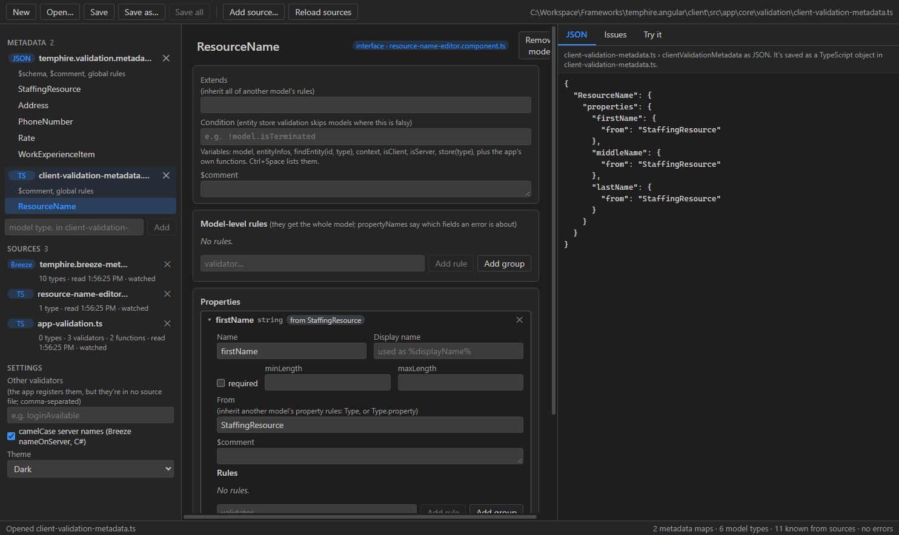

# IdeaBlade Validation Editor

A desktop editor for [IdeaBlade Validation](https://github.com/Breeze/ideablade-validation)'s JSON validation metadata (`validation.metadata.json`), so the rules no longer have to be written by hand. It's a first drop: a working prototype, not a finished product.


## What it does

- **Several metadata files, side by side, in JSON, TypeScript or C#.** Open as many as the application has: the server's `validation.metadata.json` and a client's own view model metadata, for example. Each is listed on the left with its model types; the checks, code completion and "Try it" see all of them together, merged as the library merges several metadata maps (`addMetadata`, `AddMetadataJson`). So `ResourceName.firstName`'s `from: 'StaffingResource'` in the client's TS file resolves against the server's JSON, a duplicate error key across files is caught, and a model type in two files gets a note that the library merges them.
  - **JSON files**, as before.
  - **TypeScript:** a `ModelValidationMetadataMap` object literal, as in TempHire's `client-validation-metadata.ts` (`export const x: ModelValidationMetadataMap = { ... }`, or `{ ... } satisfies ModelValidationMetadataMap`). A file with several maps opens as several documents. Saving rewrites only that object literal, in the Prettier style TempHire uses (single quotes, trailing commas, 100 columns), and keeps the file's line endings: the imports, doc comments and other code stay as they are, and an unchanged map is written back byte for byte. A map with code in it (a spread of another map, a reference to a constant) opens read-only, with the reason.
  - **C#:** the .NET library reads metadata as JSON, so in C# it's a JSON string, usually a raw string literal: `public const string Json = """ { ... } """;` passed to `AddMetadataJson`. Verbatim `@"..."` strings work too. Comments and trailing commas in the JSON are read, as .NET allows them. Saving rewrites only the string, keeping its indentation.
  - Comments inside a TS object or C# JSON can't be kept when it's rewritten: the editor says so, and asks before saving. Use `$comment` for notes that should stay.
  - **Save as…** converts: the extension you choose (.json, .ts, .cs) sets the format. A new TS file gets an `import type { ModelValidationMetadataMap }` and an exported constant named after the file; a new C# file a static class with a `Json` constant. **Save all** saves every changed document.
- **Opens, edits and saves** metadata. Model types are listed on the left. For each one you see its `extends`, `condition`, `$comment`, model-level rules (with `id`, `condition` and `propertyNames`) and properties (`from`, `displayName`, `required`, `minLength`, `maxLength`, rules). Groups (`{ "group": ..., "validators": [...] }`) are edited in place. `$schema`, `$comment` and anything the forms don't know about are kept.
- **Forms instead of raw JSON.** Validator names come from a list: the built-in validators and the application's own (see Sources). Each validator shows its description, default message and context settings: for the built-in ones from the library's `docs/validators.md` (`minValue`/`maxValue` for `range`, `other`/`op` for `compare`, `values`, and so on), for the application's from what their code reads. `pattern`'s `flags` are toggles for the flags that work the same on client and server (`i`, `m`, `s`, `u`). Each rule shows the error key it will get (`name[_group]_property`, or `name[_group]_id` for model-level rules).
- **Code completion in expressions** (model conditions, rule conditions, the `expression` validator). As you type, or with Ctrl+Space, it offers what the library puts in scope there:
  - the variables: `model`, `value` (rules only), `context`, `isClient`, `isServer`, `store(type)`, and for model conditions `entityInfos` and `findEntity(id, type)`;
  - the model's properties, with their types, and the members of those types: `model.firstName.` offers the string methods, `value.` on a date the `get…` methods, `model.addresses.` the array methods;
  - entities across the store: `store('` offers the model types, `store('Address').some(a => a.` the properties of an address; callback parameters in general get their element type;
  - what `context` always holds (`model`, `modelType`, `propertyName` or `propertyNames`, `displayName`, `messageTemplate`, `isClient`, ...) plus the rule's own settings;
  - the application's expression functions (see Sources), and the globals and methods the safe evaluator allows (`Math`, `Date`, `Number`, `Object`, ...).

  Completion only suggests: properties it doesn't know (values a context provider adds, members of a type no source describes) can still be typed. Syntax errors are underlined where the parser stops.
- **Sources: pick real models, properties, validators and functions.** Add Breeze metadata (Breeze's native JSON, as a Breeze server's `Metadata` endpoint returns it), or TypeScript or C# files with view models, DTOs and form models, and with the application's own validators and expression functions. Their types appear when you add a model, and their properties when you add a property, set `propertyNames`, `compare`'s `other`, `extends` or `from`, and in expressions. Names the sources don't know are flagged as warnings, so typos show up. Rules for models that are in no source (a view model you haven't pointed it at) still work.
  - **Breeze:** entity and complex types, with data and navigation properties. Server names (`nameOnServer`) are camel-cased, as the metadata's property names are (switch this off in Settings).
  - **TypeScript:** interfaces, object type aliases, and classes with their public properties, getters and constructor parameter properties. Angular components, services, directives and pipes are skipped, and so are validator classes. Read with the TypeScript compiler API.
  - **The application's validators, TS:** `syncValidator('name', …, 'message')`, `asyncValidator(…)`, `{ name: 'x', fn: … }` factories, and classes extending `SyncValidator` / `AsyncValidator` (`super('name', …)`, `withMessage(context, '…')`). Their settings are the context values their code reads: `ctx.factor`, `ctx['factor']`, `const { factor } = ctx`, `(value, { factor }) => …`.
  - **The application's validators, C#:** classes deriving from `Validator`, `SyncValidator` or `AsyncValidator` (`base("name", …)`, `WithMessage(context, "…")`), and `new ValidatorFactory("name", …)`. Settings come from `GetValue<T>("x")` (typed: a number becomes a number field, `bool` a checkbox), `GetValues<T>("x")` (a list) and `context["x"]`.
  - **Expression functions:** `expressionScope: { … }` and `provideExpressionScope(…)` (TS), `AddExpressionFunction("name", (Func<…>)(…))` (C#), with their parameters and return types where the code says.
  - The checks know these validators: no "unknown validator" for them, and an error when a rule's `async` doesn't match how the validator is registered. Validators that are in no source file can be listed under Settings → Other validators.
  - **C#:** classes, records (including positional parameters) and structs with their public instance properties, base classes and `[StringLength]`/`[MaxLength]` hints. This is a lightweight reader rather than a compiler, enough for DTOs and view models.
  - **Kept up to date:** each source file is watched and read again when it changes (also **Reload sources**, F5). The sources are remembered per metadata file and loaded again when you open it.
- **Checks as you edit** (Issues tab, and next to each field):
  - **Schema:** against `validation-metadata.schema.json` from the installed `ideablade-validation` package.
  - **The library:** `ideablade-validation` itself checks what the schema can't. It reports unknown validator names, `async` that doesn't match an app validator's registration, regular expression flags that are invalid or behave differently on client and server (`g`, `y`, `v`), expressions and conditions that don't parse (`checkExpression`), invalid `pattern`s, and `from`/`extends` that lead nowhere. It also runs the duplicate error key check (`ModelMetadata.checkErrorKeys`), which the service runs before it first validates a model type. Rule sources work as in the app: a `from` that names a Breeze entity resolves, as it does with `breezeRuleSource`.
  - **Sources:** properties, `propertyNames` and `compare`'s `other` that the model doesn't have.
- **JSON view** next to the forms, kept in step both ways. JSON that doesn't parse isn't applied; the forms keep the last valid state until it parses again.
- **Try it:** validate a sample object against the metadata as it is now, with the library's real service. You can give it a store (entities by type) for `store('Type')` expressions. Validators the editor doesn't have (`breeze`, custom ones) pass, and async validators don't run.
- **Dark theme** by default, with VS Code's Dark+ colours, also for the code in expressions. Settings → Theme switches to Light, or to Follow Windows; the window frame, menus and dialogs follow.

| Several files: JSON and TS side by side | Code completion in an expression | The application's own validators |
|---|---|---|
|  |  |  |

| Rules for a view model from a TS file | The duplicate error key check | Try it |
|---|---|---|
|  |  |  |

## Running it

Node 26.13.1 (the current LTS; `.node-version`). With nvs: `nvs use 26.13.1`.

```powershell
npm install
npm start
```

`npm start` builds the Angular app into `dist/` and starts Electron on it. The first start downloads the Electron binary.

While working on the editor, `npm run dev` runs `ng serve` (port 4300) with live reload and Electron pointed at it.

Metadata files (JSON, TS or C#) and sources can be given on the command line, which is handy for trying it out on TempHire:

```powershell
npm run build
npx electron . samples/temphire.validation.metadata.json ../temphire.angular/client/src/app/core/validation/client-validation-metadata.ts --source=samples/temphire.breeze-metadata.json --source=../temphire.angular/client/src/app/resource-mgt/resource-name-editor.component.ts --source=samples/app-validation.ts
```

The `samples/` folder has TempHire's validation metadata and its Breeze metadata, exported from `TempHirePersistenceManager.Metadata()`, and `app-validation.ts`, an example of an application's own validators and expression functions as the editor reads them.

### Tests

```powershell
npm test
```

Unit tests (Vitest, through Angular's test builder) cover the Breeze and C# readers, the checks on TempHire's metadata, and the tester.

## Packaging

```powershell
npm run dist
```

This builds a Windows installer with electron-builder: `release/IdeaBlade Validation Editor Setup 0.1.0.exe`. It's an NSIS installer for the current user, where you can choose the folder. `npm run dist:dir` builds only the unpacked app (`release/win-unpacked/`), which is quicker for checking the packaged build. The installer isn't code-signed and uses Electron's default icon.

npm 11 lists some packages whose install scripts it didn't run (`esbuild`, `lmdb`, `@parcel/watcher`, `electron-winstaller`, `msgpackr-extract`). The build doesn't need them: esbuild and the watchers come as prebuilt optional packages, and electron-winstaller is only for Squirrel installers.

## How it's built, and why

- **Electron**, for a desktop app that opens and saves files and watches the model sources. The main process (`electron/main.cjs`) owns the file system: dialogs, reading, saving, `fs.watch`, and reading TypeScript files, since the TypeScript compiler needs Node. The renderer is sandboxed with context isolation and gets a small API through `electron/preload.cjs`.
- **Angular 22** (standalone components, signals, zoneless) for the UI. All state is in one signal store (`src/app/editor-store.ts`): the document is the parsed JSON itself, and every edit replaces it immutably. The JSON text, the issues and the model catalog are `computed`s of it, so the forms, the JSON view and the checks can't get out of step.
- **The library itself** (`ideablade-validation` from npm) does the checks the schema can't do and runs the tester. The editor uses the same code the apps run, so it agrees with them.
- **Ajv** checks the schema. The validator is precompiled at build time (`scripts/build-schema-validator.mjs`, into `src/generated/`), so the app's Content-Security-Policy needs no `unsafe-eval`.
- The editor's own logic is plain TypeScript in `src/lib/` and doesn't depend on Angular: the document helpers, the validator catalog, the source readers, metadata in C#, expression completion, the checks and the tester. Metadata in TypeScript is read and written in `electron/typescript-metadata.cjs`, in the main process, with the TypeScript compiler. Expression fields use CodeMirror 6.

## Limitations of this first drop

- Saving a JSON file after a form edit writes the whole file in standard two-space JSON. Hand formatting is lost, such as TempHire's one-line `"global": { "validators": ["breeze"] }`. Edits in the JSON view are saved as typed. TS objects and C# strings are rewritten in a fixed style (Prettier's for TS), so hand formatting inside them is lost too, and so are comments inside them.
- Metadata built in code (TS maps put together with spreads or functions, C# built from `ModelValidationConfig` objects) can't be edited: TS maps with code open read-only, and C# is read only as JSON strings.
- The documents are listed one above the other in one window; there is no split view showing two model editors at once.
- Breeze metadata comes from a file. TempHire's `api/model/Metadata` endpoint needs a signed-in user, so save its response, or export it as `samples/` was.
- Model sources supply names, not rules: `from` a Breeze entity resolves, but in "Try it" the inherited Breeze rules (`[Required]`, `[StringLength]`) don't run.
- C# is read with patterns, not Roslyn. Unusual syntax (properties split over several lines, generics with nested angle brackets in property types) may be missed.
- A validator's settings are found only where its own code reads them (`ctx.x`, `GetValue<T>("x")`). Settings read through a helper method, or a validator class defined in a file that isn't a source, are not.
- Completion follows the types it can see: model properties, `store('Type')`, array callbacks. A value whose type no source describes (`context.someProviderValue.`, an app function returning an untyped object) gets no member suggestions.
- In "Try it", the application's validators always pass: the editor can't run their code.
- No undo beyond the JSON view's own; no drag and drop to reorder rules (use ↑/↓).
